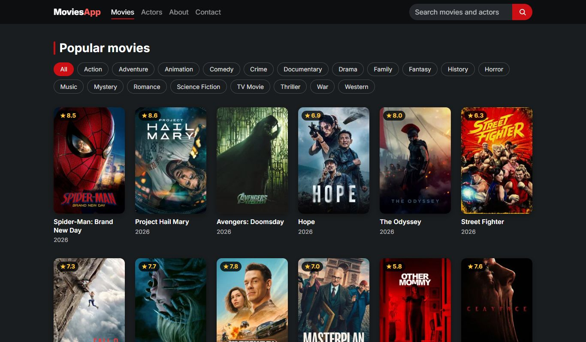
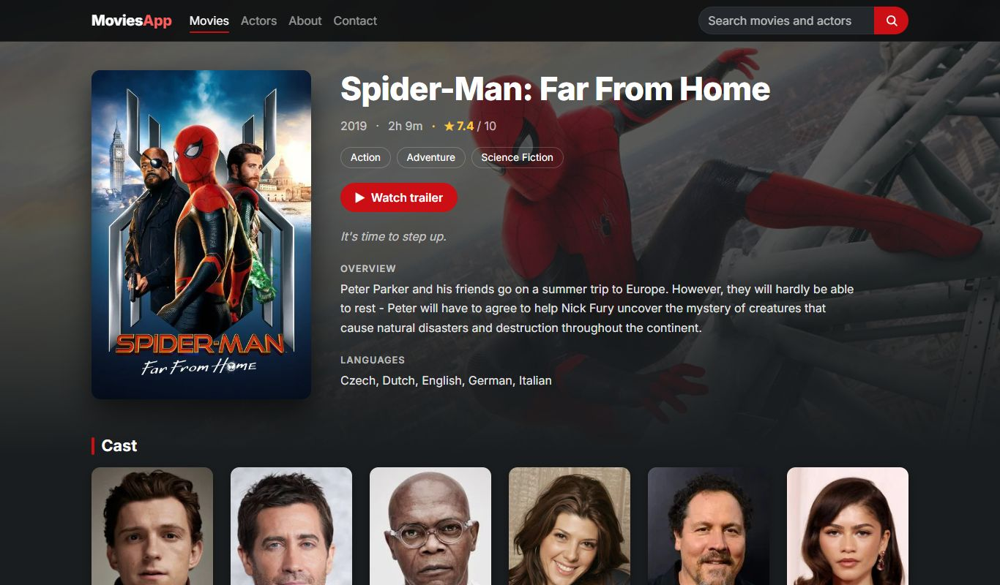
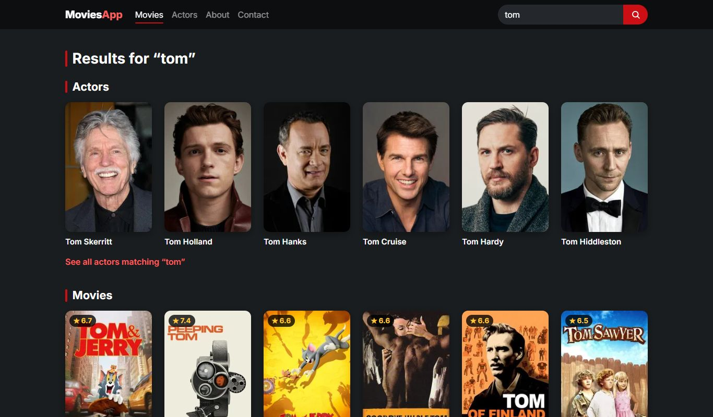

# MoviesApp

Browse popular movies and actors from [The Movie Database (TMDB)](https://www.themoviedb.org/), search movies and actors, filter by genre, and open detail pages with trailers, cast, filmography and similar titles.

Built with Angular 22 (standalone components, signals, `rxResource`) and Bootstrap 5.

**Live:** https://themoviedbproject.web.app

| Popular movies | Movie page |
| --- | --- |
|  |  |
| **Search (actors and movies)** | **Actor page on a phone** |
|  |  |

## Requirements

Node.js `^22.22.3`, `^24.15.0` or `>=26`.

## Getting started

```bash
npm install
npm start          # dev server at http://localhost:4200
npm run build      # production build in dist/movies-app
npm test           # unit tests (Vitest)
npm run e2e        # browser tests (Playwright), see below
```

The browser tests in `e2e/` cover the main flows (list → movie → actor → Back, search, genres, trailer, 404) and check that every page lines up with the navbar and footer, on a desktop and a phone viewport. TMDB is mocked, so they run offline. The first time, download a browser with `npx playwright install chromium`, or use one you already have: `PW_CHANNEL=msedge npm run e2e`.

## Routes

| URL                                       | Page                                    |
| ----------------------------------------- | --------------------------------------- |
| `/`                                       | Welcome                                 |
| `/movies`                                 | Popular movies                          |
| `/movies?genre=28`                        | Popular movies in one genre             |
| `/movies?q=batman`                        | Search results (matching actors first)  |
| `/movies/429617-spider-man-far-from-home` | Movie details                           |
| `/actors`                                 | Popular actors                          |
| `/actors?q=tom`                           | Actor search results                    |
| `/actors/1136406-tom-holland`             | Actor details                           |
| `/about`, `/contact`                      | Static pages                            |

Detail URLs use an `id-slug` segment. Only the numeric id is used for lookups; a missing or outdated slug is replaced with the canonical one.

## Deployment

Hosted on Firebase at https://themoviedbproject.web.app. See [DEPLOYMENT.md](DEPLOYMENT.md) for how to deploy, and for a note on why the site sits in the wrong Firebase project.

## Configuration

The TMDB API key lives in `src/environments/environment.ts`. TMDB keys are free and intended for client-side use, so it is committed on purpose.
